<div align="center">


</div>

<p align="center"><a href="README.md">Русская версия</a></p>

```bash
$ whoami
misxnthropy

$ cat ~/focus
focus : infosec, defense, research
stack : python · typescript · c · c++
        bash · linux · osint
        ai security (details below)
```

<p align="center"></p>

## ▓ PROJECTS

<p align="center">
<a href="https://github.com/rephuren/citadel"></a>
<a href="https://github.com/rephuren/basilisk"></a>
<a href="https://github.com/rephuren/ectoplasm"></a>
<a href="https://github.com/rephuren/ghoul"></a>
<a href="https://github.com/rephuren/shroud"></a>
<a href="https://github.com/rephuren/silhouette"></a>
<a href="https://github.com/rephuren/wyrm"></a>
</p>

**[`citadel`](https://github.com/rephuren/citadel).** Sits between an AI client and MCP servers: call policies, taint tracking, a block on the "lethal trifecta" (private data + untrusted content + an outbound channel) in one session, and pinning of tool definitions against rug pulls. Ships with a range of deliberately vulnerable demo servers and a reproducible benchmark: 9 attacks all succeed without the gateway and none with full protection.

`typescript` · `node` · `mcp` · zero dependencies · 50 tests

<details><summary>screenshot</summary>


</details>

**[`basilisk`](https://github.com/rephuren/basilisk).** Reads MCP client configs and tool lists as data and looks for what a model would read as instructions: hidden instructions, invisible Unicode, data-leaking markdown images, tool shadowing, secrets. `pin` and `verify` catch a tool definition changed after approval.

`typescript` · `node` · `sarif` · zero dependencies · 65 tests

<details><summary>screenshot</summary>


</details>

**[`ectoplasm`](https://github.com/rephuren/ectoplasm).** From a session log (Claude Code, Codex, generic JSONL) it shows which untrusted text led to a dangerous action, with a confidence level and the chain of events. PreToolUse hook, HTML report, SARIF, and an open dataset of 75 labelled synthetic sessions. Together with `basilisk` (before) and `citadel` (during) it covers the cycle before, during and after.

`python` · `sarif` · `github action` · 93 tests

<details><summary>screenshot</summary>


</details>

**[`ghoul`](https://github.com/rephuren/ghoul).** Pretends to be a compromised server and records which passwords bots try, which commands they run and where they download malware from. The shell is fake; nothing is executed.

`python` · `asyncssh` · `sqlite` · own web dashboard

<details><summary>screenshot</summary>


</details>

**[`shroud`](https://github.com/rephuren/shroud).** Finds data in file tails, metadata and pixel low bits (zsteg-style LSB, RS analysis, chi-square, JPEG DCT); every verdict is explained.

`python` · `numpy` · `pillow` · 24 tests

<details><summary>screenshot</summary>


</details>

**[`silhouette`](https://github.com/rephuren/silhouette).** Shows what a domain exposes: subdomains, dangling CNAMEs, headers, email hardening, an A-F grade and a diff between scans. Passive by default; probing needs an explicit authorization flag. Adds `meta` (metadata of your own files), `--shodan` and `--nuclei`.

`python` · `dnspython` · `sqlite` · 100 tests

<details><summary>screenshot</summary>


</details>

**[`wyrm`](https://github.com/rephuren/wyrm).** Mutates input, tracks coverage through a shared-memory map and keeps whatever crashes the target under ASan/UBSan. Own instrumentation, crash minimizer, persistent mode and parallel workers.

`c++` · `clang` · `asan` · `ubsan` · 39 tests

<details><summary>screenshot</summary>


</details>

> **Project status.** Screenshots of `ghoul`, `shroud`, `silhouette` and `ectoplasm` come from demo mode on synthetic data. `wyrm` and `basilisk` output comes from runs on training targets. The `citadel` table was computed on a range with a deliberately naive agent. Methodology and limitations are described in each project's README.

<p align="center"></p>

## ▓ CONTACT

- telegram: [@rephuren](https://t.me/rephuren) · [@wx1ze](https://t.me/wx1ze)
- email: [misxnthropy@gmail.com](mailto:misxnthropy@gmail.com)

<p align="center"></p>
