&nbsp;

## ▓ PROJECTS

<!-- projects:start -->

A gateway between an AI client and MCP servers: call policies, taint tracking, definition pinning. On the range, 9 of 9 attacks pass without the gateway and none with it; the range is deliberately simple.

Finds what a model would read as a command in MCP configs and tool descriptions, and catches definitions swapped after approval. Static analysis, false positives are possible.

From an agent session log, shows which foreign text led to a dangerous action, with a confidence level and the event chain. Demo on synthetic sessions.

A test stand for LLM apps: 18 attacks with canaries in the prompt, mapped to the OWASP LLM Top 10 and MITRE ATLAS. Not run against a real model.

Rack middleware for Ruby: notices scanners and injections, serves decoys with fake keys and catches their use. Not run on a real site, observe-only by default.

A rule engine in Rust: a Sigma and YARA subset, logs and files, an ATT&CK summary. Whatever it does not understand is rejected with a reason. Tested on my own rules, not on SigmaHQ.

A passive network sensor: a C core reads pcap, a Go analyzer finds beacons, DNS tunnels and scans. The core was fuzzed with wyrm without crashes; not run on live traffic.

ELF and PE dissection in Go: hardening, imports, entropy, strings, ImHex patterns. ImHex and the teaching labs were not run live.

An SSH trap with a fake shell: records passwords, commands and download links from bots, executes nothing. Demo on synthetic data, not on real bots.

Looks for hidden data in images: file tails, metadata, LSB, RS analysis, chi-square. Every verdict is explained, but it is statistical and not proof.

Shows a domain's external attack surface: subdomains, dangling CNAMEs, email hardening, an A-F grade and the diff between scans. Shodan and nuclei are checked on mocks only.

A C++ fuzzer in the AFL spirit: coverage, crash minimizer, persistent mode, workers. Applied to the chimera core; slower and less clever than AFL++.

<!-- projects:end -->

## ▓ CONTACT

- telegram: [@rephuren](https://t.me/rephuren) · [@wx1ze](https://t.me/wx1ze)
- email: [misxnthropy@gmail.com](mailto:misxnthropy@gmail.com)

