&nbsp;

## ▓ PROJECTS

<table>
<tr><td width="50%" valign="top"> A gateway between an AI client and MCP servers: policies, taint tracking, tool-definition pinning.</td><td width="50%" valign="top"> Finds hidden instructions and swapped definitions in MCP configs and tool descriptions.</td></tr>
<tr><td width="50%" valign="top"> From an agent session log, shows which foreign text led to a dangerous action.</td><td width="50%" valign="top"> A test stand for LLM apps: 18 attacks mapped to OWASP LLM Top 10 and MITRE ATLAS.</td></tr>
<tr><td width="50%" valign="top"> A Sigma and YARA subset in Rust: logs, files, an ATT&CK summary.</td><td width="50%" valign="top"> A passive sensor: a C core reads pcap, a Go analyzer finds beacons and DNS tunnels.</td></tr>
<tr><td width="50%" valign="top"> ELF and PE dissection in Go: hardening, imports, entropy, strings, ImHex patterns.</td><td width="50%" valign="top"> An SSH trap with a fake shell: passwords, commands and links from bots, live dashboard.</td></tr>
<tr><td width="50%" valign="top"> A steganography detector for images: file tails, LSB, RS analysis.</td><td width="50%" valign="top"> A domain's external attack surface: subdomains, dangling CNAMEs, A-F grade, scan diff.</td></tr>
<tr><td width="50%" valign="top"> A coverage-guided C++ fuzzer with a crash minimizer and persistent mode.</td><td width="50%"></td></tr>
</table>

screenshots

**`citadel`**

**`basilisk`**

**`ectoplasm`**

**`ghoul`**

**`shroud`**

**`silhouette`**

**`wyrm`**

> **Project status.** Screenshots of `ghoul`, `shroud`, `silhouette` and `ectoplasm` come from demo mode on synthetic data. `wyrm` and `basilisk` output comes from runs on training targets. `exorcist`, `banshee` and `chimera` were checked only on their own teaching rules, mocks and synthetic data. The `citadel` table was computed on a range with a deliberately naive agent. Methodology and limitations are described in each project's README.

## ▓ CONTACT

- telegram: [@rephuren](https://t.me/rephuren) · [@wx1ze](https://t.me/wx1ze)
- email: [misxnthropy@gmail.com](mailto:misxnthropy@gmail.com)

