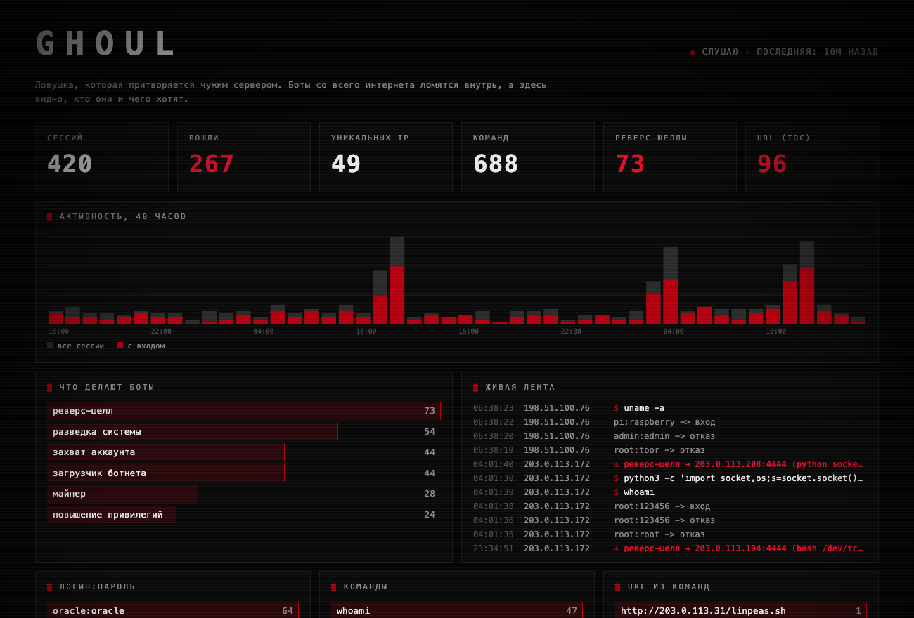
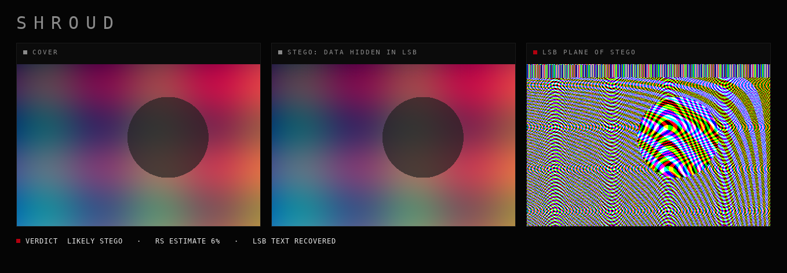
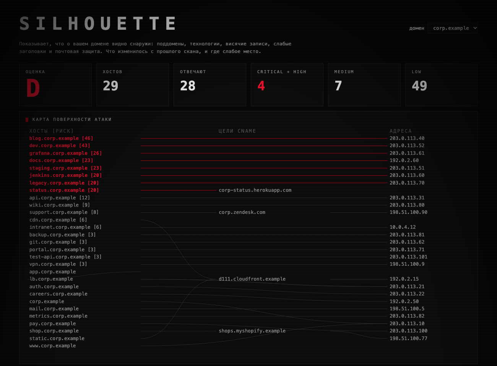

<div align="center">



</div>

```bash
$ whoami
misxnthropy

$ cat ~/focus
направление : информационная безопасность, защита и исследование
сейчас      : ловушки для атакующих и разбор того, что они делают
стек        : python · c · c++ · bash · linux · osint · ai security (ниже подробно)
```

## ▓ СТЕК

**ЯЗЫКИ**

            

**РАЗВЕДКА И СЕТЬ**

      

**ВЕБ**

      

**OSINT**

           

**ЦЕНЗУРА И ПРИВАТНОСТЬ СЕТИ**

    

**AI / LLM SECURITY**

     

**ДЕТЕКТ И BLUE TEAM**

      

**ЭКСПЛУАТАЦИЯ**

           

**РЕВЕРС, ФОРЕНЗИКА, СТЕГО**

           

**СРЕДА**

        

## ▓ СЕТАП

```bash
$ neofetch --machines

mac
  модель : MacBook Pro · Apple M5 (10 ядер)
  память : 16 GB · 512 GB ssd
  ос     : macOS 26

pc
  cpu    : AMD Ryzen 7 5700X
  gpu    : NVIDIA RTX 3080
  ram    : 64 GB DDR4 · HyperX Renegade RGB
  плата  : MSI B450
  ос     : Windows (твикнутая) · Kali Linux (dual boot)
```

## ▓ ПРОЕКТЫ

### [`ghoul`](https://github.com/rephuren/ghoul): SSH-ловушка с живым дашбордом

Притворяется взломанным сервером. Боты со всего интернета заходят внутрь, а `ghoul` записывает пароли, которые они перебирают, команды, которые запускают, и адреса, откуда скачивают вредоносы. Распознаёт попытки реверс-шелла и приёмы повышения привилегий. Ничего из этого не исполняется, оболочка поддельная.

`python` · `asyncssh` · `sqlite` · свой веб-дашборд · лимиты и ротация базы



### [`shroud`](https://github.com/rephuren/shroud): детектор стеганографии в изображениях

Находит данные, спрятанные в картинке: в хвосте файла, в метаданных и в младших битах пикселей. Разбирает структуру PNG/JPEG/GIF/BMP, читает LSB в типичных порядках, как `zsteg`, и статистикой (RS-анализ, хи-квадрат) оценивает долю заполнения. Каждый вывод объяснён.

`python` · `numpy` · `pillow` · 24 теста



### [`silhouette`](https://github.com/rephuren/silhouette): монитор внешней поверхности атаки

Показывает, что о домене видно снаружи: поддомены из журналов сертификатов, висячие CNAME и возможный захват поддомена, слабые заголовки, версии ПО, почтовая защита. По умолчанию пассивный; активное зондирование включается только явным флагом с подтверждением права на проверку. Считает оценку A–F и показывает, что изменилось с прошлого скана.

`python` · `dnspython` · `sqlite` · 45 тестов



### [`wyrm`](https://github.com/rephuren/wyrm): coverage-guided фаззер в духе AFL

Мутирует входные данные, следит за покрытием кода через shared-memory карту и сохраняет всё, что роняет цель под ASan/UBSan. Своя инструментация покрытия, мутатор в стиле havoc, минимизатор крашей на delta-debugging, persistent-режим (в сотни раз быстрее на чистых целях) и параллельные воркеры с общим корпусом. Четыре учебные цели с намеренными багами как полигон.

`c++` · `clang` · `asan` · `ubsan` · 36 тестов

```
запусков: 4000   покрытие: 280 рёбер   корпус: 9 входов   крашей: 30   скорость: 107/с
  ▓ crashes/crash-1.bin  — targets/vuln_buffer.cpp:15:36: index 16 out of bounds for type 'char[16]'
  ▓ crashes/crash-3.bin  — targets/vuln_buffer.cpp:31:18: index 903218 out of bounds for type 'int[4]'
```

> Скриншоты — демо-режим на синтетических данных. Реальных скачиваний и сканов пока нет. Вывод `wyrm` — настоящий прогон на учебных целях.

## ▓ СТАТИСТИКА

<div align="center">


</div>

## ▓ КОНТАКТЫ

- telegram: [@rephuren](https://t.me/rephuren) · [@wx1ze](https://t.me/wx1ze)
- почта: [misxnthropy@gmail.com](mailto:misxnthropy@gmail.com)
