

&nbsp;<a href="README.en.md">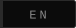</a>

## ▓ ПРОЕКТЫ

<a href="https://github.com/rephuren/ectoplasm"></a>

<a href="https://github.com/rephuren/chimera"></a>

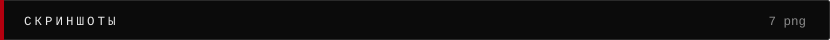

**`citadel`**

**`basilisk`**

**`ectoplasm`**

**`ghoul`**

**`shroud`**

**`silhouette`**

**`wyrm`**


## ▓ СТЕК

<!-- stack:start -->

 

<a href="https://www.rust-lang.org">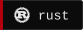</a>

<a href="https://learn.microsoft.com/powershell/">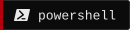</a>
<a href="https://www.typescriptlang.org">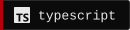</a>
<a href="https://nodejs.org">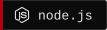</a>
<a href="https://developer.mozilla.org/docs/Web/JavaScript">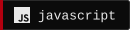</a>
<a href="https://en.wikipedia.org/wiki/SQL">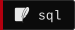</a>
<a href="https://en.wikipedia.org/wiki/X86_assembly_language">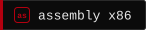</a>
<a href="https://github.com/WerWolv/ImHex-Patterns">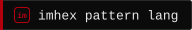</a>

 
<a href="https://nmap.org">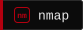</a>
<a href="https://github.com/robertdavidgraham/masscan">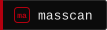</a>

<a href="https://www.tcpdump.org">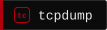</a>
<a href="https://nmap.org/ncat/">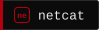</a>
<a href="https://github.com/traviscross/mtr">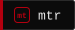</a>
<a href="https://www.isc.org/bind/">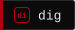</a>

 
<a href="https://portswigger.net/burp">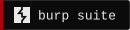</a>
<a href="https://github.com/urbanadventurer/WhatWeb">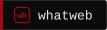</a>
<a href="https://github.com/projectdiscovery/nuclei">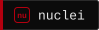</a>
<a href="https://sqlmap.org">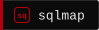</a>
<a href="https://github.com/ffuf/ffuf">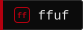</a>

 
<a href="https://github.com/smicallef/spiderfoot">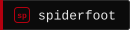</a>

<a href="https://www.shodan.io">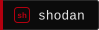</a>
<a href="https://censys.com">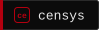</a>
<a href="https://github.com/lanmaster53/recon-ng">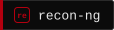</a>
<a href="https://github.com/laramies/theHarvester">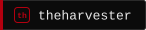</a>
<a href="https://github.com/owasp-amass/amass">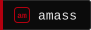</a>
<a href="https://exiftool.org">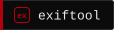</a>
<a href="https://pypi.org/project/pic2map/">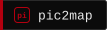</a>
<a href="https://github.com/sherlock-project/sherlock">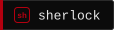</a>

<a href="https://osintframework.com">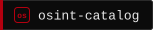</a>

 
<a href="https://github.com/search?q=dpi-detector&type=repositories">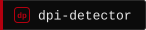</a>
<a href="https://www.torproject.org">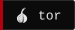</a>

<a href="https://www.wireguard.com">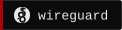</a>
<a href="https://github.com/rephuren/chimera">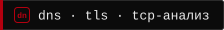</a>

 
<a href="https://github.com/NVIDIA/garak">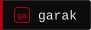</a>
<a href="https://github.com/Azure/PyRIT">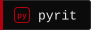</a>
<a href="https://www.promptfoo.dev">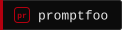</a>
<a href="https://genai.owasp.org/llm-top-10/">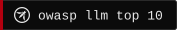</a>
<a href="https://atlas.mitre.org">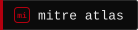</a>

 
<a href="https://github.com/SigmaHQ/sigma">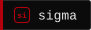</a>
<a href="https://virustotal.github.io/yara/">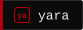</a>
<a href="https://suricata.io">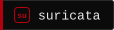</a>

<a href="https://github.com/redcanaryco/atomic-red-team">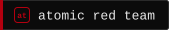</a>
<a href="https://github.com/rephuren/ghoul">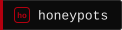</a>

 
<a href="https://www.metasploit.com">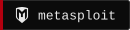</a>
<a href="https://github.com/Gallopsled/pwntools">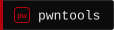</a>

 

 

<!-- stack:end -->

## ▓ СТАТИСТИКА

## ▓ КОНТАКТЫ

- telegram: [@rephuren](https://t.me/rephuren) · [@wx1ze](https://t.me/wx1ze)
- почта: [misxnthropy@gmail.com](mailto:misxnthropy@gmail.com)

